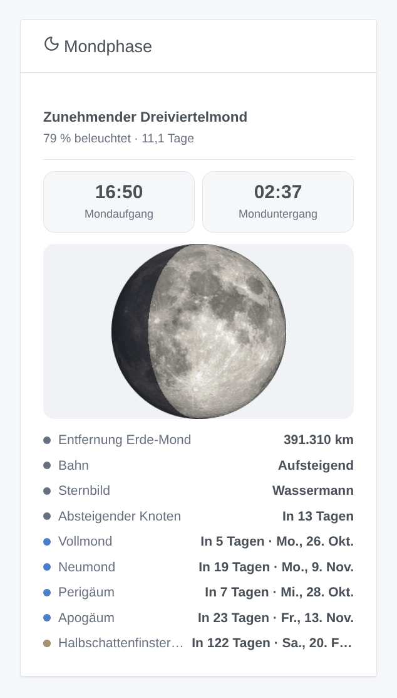
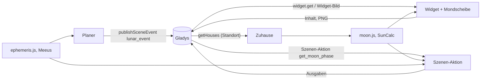
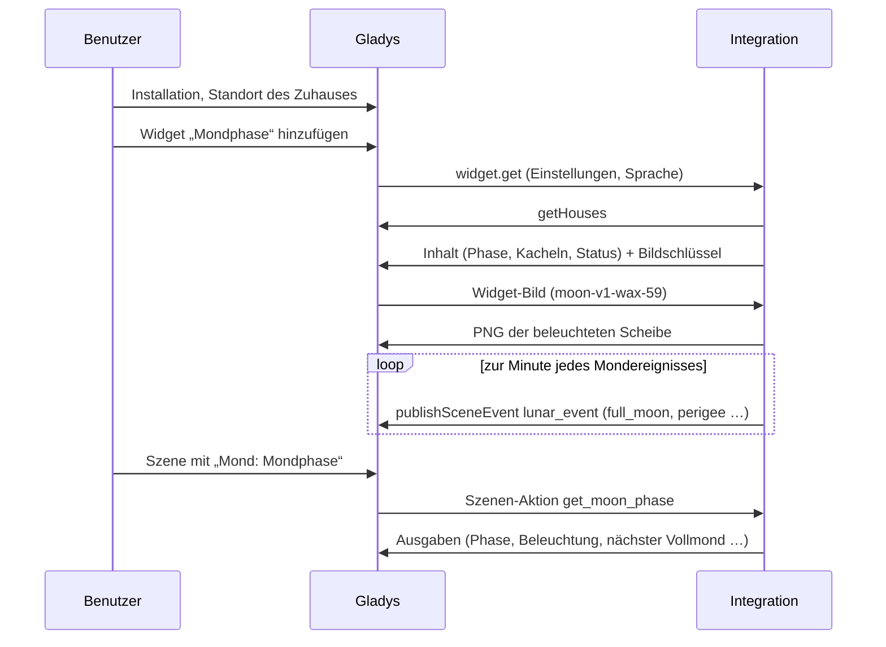
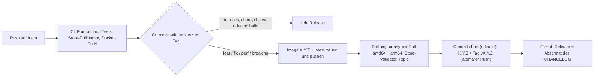

# Gladys Mondphase

[English](README.md) · [Français](README.fr.md) · **Deutsch** · [Español](README.es.md)

[](LICENSE)
[](https://github.com/William-De71/gladys-moon-phase/releases)
[](https://github.com/William-De71/gladys-moon-phase/actions/workflows/release.yml)
[](https://gladysassistant.com)


Externe Integration für [Gladys Assistant](https://gladysassistant.com), die ein **Dashboard-Widget „Mondphase“**
hinzufügt: Phase, Beleuchtung und Alter, die Mondscheibe, Mondauf- und -untergang und die nächsten Mondereignisse
(Voll- und Neumond, Perigäum, Apogäum, Mondfinsternis). Szenen erhalten einen **Auslöser zur Minute jedes
Mondereignisses** und eine **Aktion, die die Mondphase liefert**. Gebaut auf `@gladysassistant/integration-sdk`
0.15.

**Keine Konfiguration, vollständig lokal**: Alles wird aus dem Standort des Zuhauses berechnet, ohne Konto, ohne
Schlüssel und ohne Internetzugang.



Benutzerdokumentation: [English](docs/en.md) · [Français](docs/fr.md) · [Deutsch](docs/de.md) ·
[Español](docs/es.md).

## Inhalt

- [Funktionen](#funktionen)
- [Architektur](#architektur)
- [Installation](#installation)
- [Konfiguration](#konfiguration)
- [Herkunft](#herkunft)
- [Das Widget](#das-widget)
- [Szenen](#szenen)
- [Entwicklung](#entwicklung)
- [Release und Commit-Konvention](#release-und-commit-konvention)
- [Fehlerbehebung](#fehlerbehebung)
- [Mitwirken](#mitwirken)
- [Danksagung](#danksagung)
- [Lizenz](#lizenz)

## Funktionen

- **Widget** `moon`: Phase, beleuchteter Anteil und Alter, die beleuchtete Mondscheibe (NASA-Foto), Mondauf- und
  -untergang, dann Entfernung, Bahn, Sternbild und nächster Knoten des Tages sowie nächster Vollmond, Neumond,
  Perigäum, Apogäum und Mondfinsternis mit ihrem Countdown.
- **Szenen-Auslöser** `lunar_event`: zur Minute eines Neumonds, ersten Viertels, Vollmonds, letzten Viertels,
  Perigäums, Apogäums oder einer Mondfinsternis, mit einem Filter auf das Ereignis.
- **Szenen-Aktion** `get_moon_phase`: Phase, Beleuchtung, Alter, Mondauf- und -untergang eines Zuhauses, nächster
  Voll- und Neumond und ein fertiger Satz.
- **Transport**: `local` (die Integration erscheint unter „Lokal“ in Gladys): Nichts verlässt den Container.
- **Sprachen**: Englisch, Französisch, Deutsch und Spanisch (Manifest, Widget, Szenentexte, Docs).

## Architektur




Vom Dashboard zu einer Szene:



Die Integration deklariert `transports: ["local"]`: Sie berechnet alles in ihrem Container und spricht nur mit
Gladys.

## Installation

In Gladys: **Integrationen → Store → Mondphase → Installieren**. Lege den Standort des Zuhauses fest
(**Einstellungen → Zuhause**) und füge dann das Widget **Mondphase** einem Dashboard hinzu. Siehe die
[Benutzerdokumentation](docs/de.md).

Docker-Image: `ghcr.io/william-de71/gladys-moon-phase`, Multi-Arch (amd64/arm64), kein Root, schreibgeschütztes
Dateisystem, schreibt nur in `/data`, OCI-Labels und das Manifest im Label `io.gladysassistant.manifest`.

## Konfiguration

| Schlüssel  | Typ      | Hinweise                                                                                       |
| ---------- | -------- | ---------------------------------------------------------------------------------------------- |
| `language` | `select` | Sprache der Szenentexte: `auto` (Standard, die Sprache des Dashboards), `en`, `fr`, `de`, `es` |

Interner Schlüssel (außerhalb des Schemas): `last_language`, die Sprache der letzten Widget-Anfrage. Das Widget
selbst hat drei Einstellungen (Zuhause, Details, Berechnung um Mitternacht), siehe unten.

## Herkunft

Dieses Widget entstand als Widget des Gladys-Kerns (PR #2990, Branch `feat/moon-phase-widget`). Es wurde zu einer
externen Integration, um den Kern nicht zu belasten: Die Berechnung ist eine Portierung von
`server/lib/house/house.getMoonState.js` (gleiche `suncalc`-Version, gleiche Reihen, gleiche Suchen), und ihre Tests
sind in `test/moon.test.js` portiert. Ein Vergleich über 864 Zeitpunkte des Jahres 2026 (Paris, Sydney, New York,
live und um Mitternacht) ergab streng identische Ergebnisse.

## Das Widget

Eine `provider`-Integration (Manifest `type: "provider"`): keine Geräte, ein Widget, `moon`.

| Kern-Widget (PR #2990)                                              | Diese Integration                                            |
| ------------------------------------------------------------------- | ------------------------------------------------------------ |
| Name der Phase                                                      | `text` Überschrift                                           |
| „75 % beleuchtet · 10,2 Tage“                                       | `text` Untertitel                                            |
| Mondscheibe: NASA-Foto, Schatten #11131c zu 70 %                    | `image`, dasselbe Foto serverseitig schattiert (PNG, 256 px) |
| Mondauf- / -untergang                                               | zwei `value`-Kacheln                                         |
| „Heute“: Entfernung, Bahn, Sternbild, nächster Knoten               | die ersten vier Zeilen der `status`-Liste                    |
| „Demnächst“: Voll- / Neumond, Perigäum, Apogäum, Finsternis + Datum | die fünf nächsten Zeilen, „In 5 Tagen · Fr., 28. Aug.“       |
| Countdowns in Kalendertagen des Zuhauses (Fix e15d92ba2)            | ebenso, in der Zeitzone von Gladys                           |
| Einstellungen: Zuhause, Details anzeigen, um Mitternacht berechnen  | dieselben drei Widget-Einstellungen                          |
| Texte auf Englisch, Französisch, Deutsch                            | dieselben Texte, dazu Spanisch (andere Sprache: Englisch)    |

6 Komponenten von einem Budget von 8. Was das Vokabular nicht ausdrücken kann (die Scheibe neben dem Text statt
eines 16:9-Rahmens in voller Breite, zwei Abschnitte mit Titel, das Datum in Grau neben dem Countdown), wurde beim
Test des Widget-Vokabulars aufgelistet (Branch `feat/dev-widget-test`, `CORE-NEEDS.md`).

### Zeitzone

Der Supervisor startet jeden Integrationscontainer mit `TZ` auf der Zeitzone von Gladys: Mondauf- und -untergang,
der Zeitpunkt „um Mitternacht berechnen“ und die Tages-Countdowns folgen ihr (`src/time.js`, auf `Intl`, ohne
Datumsbibliothek). Die Lebensdauer des Inhalts beträgt 10 Minuten und endet verkürzt kurz nach Mitternacht, damit
die Countdowns pünktlich weiterzählen; um Mitternacht berechnete Werte werden bis zu einer Stunde behalten.

### Zuhause

Die Einstellung „Zuhause“ ist ein freier Text: der Name oder Selektor des Zuhauses, ohne Beachtung der
Groß-/Kleinschreibung; leer bedeutet das erste Zuhause mit Standort. Eine Liste der Zuhause (`source: "houses"`)
gibt es im Master-Branch von Gladys, aber in noch keiner Version, und Gladys 5.1 lehnt ein Manifest ab, das sie
verwendet. Die Zuhause werden über die Host-API gelesen (`location: true`, `getHouses()`), höchstens einmal pro
Minute.

### Bild

Die Scheibe wird über `onWidgetGetImage` geliefert. Der Schlüssel trägt alles, wovon die Zeichnung abhängt
(`moon-v1-wax-59`: Version der Zeichnung, zu- oder abnehmend, beleuchteter Anteil): Die Bytes ändern sich nur, wenn
sich der Schlüssel ändert, und die Scheibe wird nach einem Neustart allein aus dem Schlüssel neu gezeichnet.
Gezeichnet mit `pngjs` (reines JavaScript, keine native Binärdatei pro Architektur), etwa 90 KB, im Speicher
gehalten (höchstens 202 Schlüssel).

Wie im Kern-Widget bleibt der Schatten senkrecht, wie auf einem Mondkalender (rechts beleuchtet bei zunehmendem
Mond).

## Szenen

### Auslöser „Mond: Mondereignis“

| Ereignis (`event`) | Wann                                                                       |
| ------------------ | -------------------------------------------------------------------------- |
| `new_moon`         | Mond und Sonne haben dieselbe Länge                                        |
| `first_quarter`    | 90° Abstand                                                                |
| `full_moon`        | 180° Abstand                                                               |
| `last_quarter`     | 270° Abstand                                                               |
| `perigee`          | der Mond ist der Erde am nächsten                                          |
| `apogee`           | der Mond ist am weitesten von der Erde entfernt                            |
| `lunar_eclipse`    | ein Vollmond nahe genug an einem Knoten (Halbschatten-, partielle, totale) |

Filter: die Ereignisse, auf die reagiert wird (leer: alle). Variablen: `event`, `event_name`, `date`, `time`,
`illumination`, `distance_km`, `summary` („Vollmond um 05:11: Der Mond ist zu 100 % beleuchtet, 368.600 km von der
Erde entfernt.“).

Das Widget behält die Berechnung des Kern-Widgets (SunCalc), dessen „Phase“ ein Phasenwinkel ist: Sein Vollmond
kann Stunden vom astronomischen entfernt liegen. Der Auslöser braucht die Minute: Seine Zeitpunkte stammen aus
`src/ephemeris.js`, mit den Hauptgliedern der Reihe ELP-2000/82 nach J. Meeus (_Astronomical Algorithms_, Kapitel 47)
und der Sonne aus Kapitel 25. Gegen PyEphem über 200 Phasen (2026-2033) geprüft: höchstens 3 Minuten Abweichung;
Perigäum und Apogäum auf 34 Minuten genau (die Entfernungskurve ist dort flach). Eine Finsternis wird auf ihren
Vollmond datiert (weniger als eine halbe Stunde vom Maximum der Finsternis).

Jedes Ereignis wird nur einmal ausgelöst (40 Tage in `/data/fired.json` gespeichert, ein Neustart löst es also nie
erneut aus); ein um mehr als 10 Minuten verpasstes Ereignis (Container gestoppt) wird verworfen, und die
Veröffentlichung wird jede Minute wiederholt, solange Gladys nicht erreichbar ist.

Beispiele: die Gartenbeleuchtung auf die Szene „Vollmond“ schalten, am Abend einer Mondfinsternis eine Nachricht
erhalten, an das Säen bei Neumond erinnern.

### Aktion „Mond: Mondphase“

Feld: das Zuhause (leer: das erste Zuhause mit Standort). Ausgaben: `phase_name`, `phase` (0 Neumond, 0,5
Vollmond), `illumination`, `age_days`, `waxing`, `moonrise`, `moonset` (HH:MM, leer, wenn der Mond an diesem Tag
nicht auf- oder untergeht), `next_full_moon`, `days_until_full_moon`, `next_new_moon`, `days_until_new_moon`,
`summary`.

Die Szenentexte folgen der Einstellung **Sprache der Szenentexte**: Gladys übergibt die Sprache nur an die Widgets.

## Entwicklung

```bash
npm install
npm run format:check
npm run lint
npm test
npx github:GladysAssistant/integration-store . --skip-image-check
docker build -t gladys-moon-phase .
```

Node 22 oder neuer. `npm start` braucht ein laufendes Gladys (das SDK liest `GLADYS_HOST_API_URL`,
`GLADYS_INTEGRATION_TOKEN` und `GLADYS_INTEGRATION_SELECTOR`, vom Supervisor gesetzt). Die Tests (`node --test`)
greifen nie auf das Netz zu. Über die Unit-Tests hinaus:

- `test/structure.test.js` vergleicht jeden Schlüssel des Manifests und die Bildschlüssel mit
  `test/fixtures/discovery.baseline.json` (Version 1.0.0): Bei einem Update geht keine Widget-Einstellung verloren;
- `test/i18n.test.js` prüft die vier Sprachen (Manifest, Laufzeittexte, Docs, READMEs) und validiert das Widget in
  jeder;
- `test/events.test.js` prüft die Zeitpunkte der Mondereignisse gegen PyEphem;
- `test/release.test.js` deckt das Release-Skript ab (Version, Changelog, Versionssprung).
- `docs/illustrations/render.sh` erzeugt die Widget-Illustrationen in `docs/assets` aus dem Widget-Code neu
  (Headless-Chrome, Styles des Gladys-Frontends): nach jeder Änderung am Widget erneut ausführen.

`gladys_version` ist `>=5.1.1` (Widgets, Szenen-Auslöser und -Aktionen externer Integrationen). Nur für die
Entwicklung verschiebt `MOON_DATA_DIR` die Dateien von `/data`.

## Release und Commit-Konvention

Releases laufen automatisch. Jeder Push auf `main` startet den Release-Workflow:



- Commits und PR-Titel folgen den [Conventional Commits](https://www.conventionalcommits.org/), auf Englisch, für
  den Benutzer geschrieben: Sie werden zu den Zeilen des Changelogs. `feat` → minor, `fix` / `perf` → patch, `!`
  oder `BREAKING CHANGE:` → major.
- `CHANGELOG.md` wird beim Release erzeugt: nie von Hand bearbeiten.
- Das Image wird veröffentlicht und geprüft, **bevor** das Manifest auf `main` die neue Version ankündigt.
- Manueller Start (Actions → Release → Run workflow): `release-as` erzwingt eine Version, `dry-run` zeigt nur die
  Version und die Notizen.
- Ein geschütztes `main` würde den Release-Commit ablehnen: Erlaube GitHub Actions, die Regel zu umgehen, oder
  nutze das Token einer GitHub App.

## Fehlerbehebung

| Symptom                                     | Wahrscheinliche Ursache                                                                    |
| ------------------------------------------- | ------------------------------------------------------------------------------------------ |
| „Kein Zuhause in Gladys hat einen Standort“ | lege den Standort eines Zuhauses unter Einstellungen → Zuhause fest                        |
| „Kein Zuhause namens …“                     | die Einstellung Zuhause passt zu keinem Zuhause: Die Meldung listet die zu nutzenden Namen |
| Falsche Uhrzeiten                           | prüfe die Zeitzone von Gladys (Einstellungen → System) und starte die Integration neu      |
| Szenentexte auf Englisch                    | stelle **Sprache der Szenentexte** ein oder zeige das Widget einmal an                     |
| Kein `lunar_event` nach einem Neustart      | ein um mehr als 10 Minuten verpasstes Ereignis wird absichtlich verworfen                  |

Ausführliche Logs: Setze die Umgebungsvariable `DEBUG=gladys-integration-sdk` am Container.

## Mitwirken

Issues und Pull Requests sind willkommen: Fehlerberichte mit der Gladys-Version, der Version der Integration, der
Zeitzone und Hemisphäre des Zuhauses und den Logs ([Issue-Vorlagen](.github/ISSUE_TEMPLATE)). Rückmeldungen auch
gern im [Thread des Gladys-Forums](https://community.gladysassistant.com/t/integration-externe-phase-de-la-lune/11042).
Sicherheitsprobleme: siehe [SECURITY.md](SECURITY.md).

## Danksagung

Mondfoto: NASA’s Scientific Visualization Studio, gemeinfrei — siehe [assets/CREDITS.md](assets/CREDITS.md).

## Lizenz

[Apache-2.0](LICENSE) — siehe [NOTICE](NOTICE).
