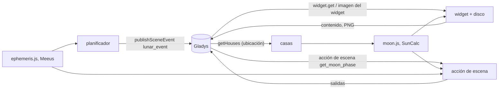
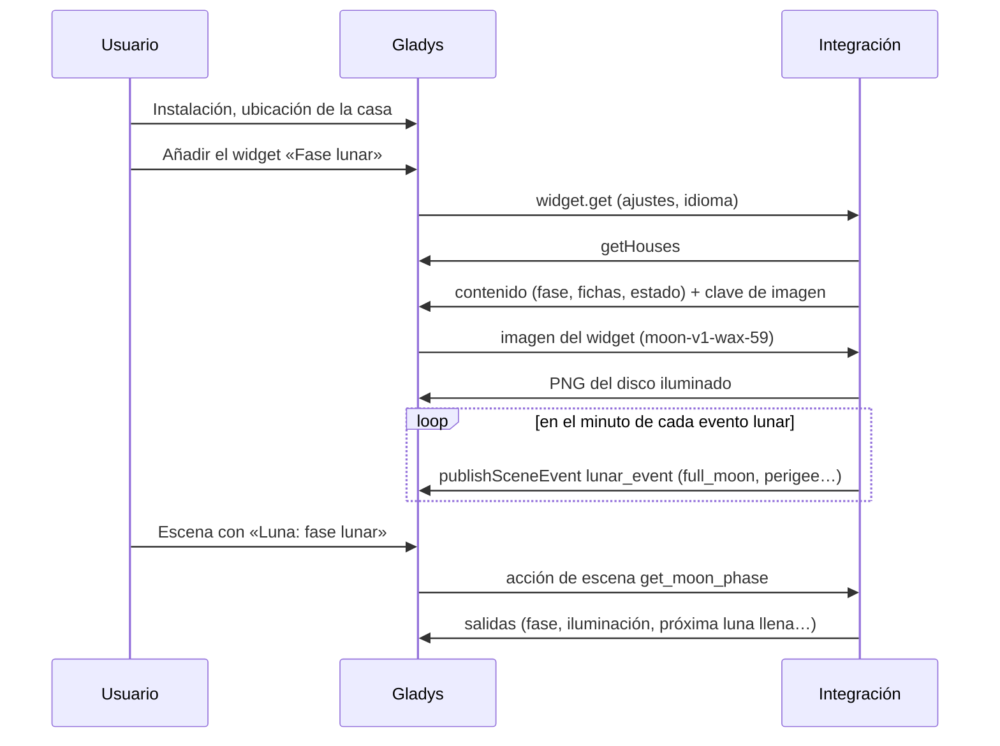
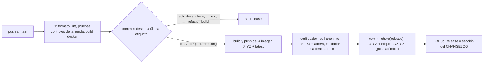

# Gladys Fase lunar

[English](README.md) · [Français](README.fr.md) · [Deutsch](README.de.md) · **Español**

[](LICENSE)
[](https://github.com/William-De71/gladys-moon-phase/releases)
[](https://github.com/William-De71/gladys-moon-phase/actions/workflows/release.yml)
[](https://gladysassistant.com)


Integración externa de [Gladys Assistant](https://gladysassistant.com) que añade un **widget del panel «Fase
lunar»**: fase, iluminación y edad, el disco lunar, salida y puesta, y los próximos eventos lunares (luna llena y
nueva, perigeo, apogeo, eclipse lunar). Las escenas disponen de un **disparador en el minuto de cada evento lunar** y
de una **acción que da la fase lunar**. Construida sobre `@gladysassistant/integration-sdk` 0.15.

**Sin configuración, totalmente local**: todo se calcula a partir de la ubicación de la casa, sin cuenta, sin clave
y sin acceso a Internet.

Documentación de usuario: [English](docs/en.md) · [Français](docs/fr.md) · [Deutsch](docs/de.md) ·
[Español](docs/es.md).

## Contenido

- [Funciones](#funciones)
- [Arquitectura](#arquitectura)
- [Instalación](#instalación)
- [Configuración](#configuración)
- [Origen](#origen)
- [El widget](#el-widget)
- [Escenas](#escenas)
- [Desarrollo](#desarrollo)
- [Release y convención de commits](#release-y-convención-de-commits)
- [Solución de problemas](#solución-de-problemas)
- [Contribuir](#contribuir)
- [Créditos](#créditos)
- [Licencia](#licencia)

## Funciones

- **Widget** `moon`: fase, porcentaje iluminado y edad, el disco lunar iluminado (foto de la NASA), salida y puesta,
  luego la distancia, la trayectoria, la constelación y el próximo nodo del día, y la próxima luna llena, luna
  nueva, perigeo, apogeo y eclipse lunar con su cuenta atrás.
- **Disparador de escena** `lunar_event`: en el minuto de una luna nueva, un cuarto creciente, una luna llena, un
  cuarto menguante, un perigeo, un apogeo o un eclipse lunar, con un filtro sobre el evento.
- **Acción de escena** `get_moon_phase`: la fase, la iluminación, la edad, la salida y la puesta para una casa, la
  próxima luna llena y nueva, y una frase lista para usar.
- **Transporte**: `local` (la integración aparece en «Local» en Gladys): nada sale del contenedor.
- **Idiomas**: inglés, francés, alemán y español (manifiesto, widget, textos de escena, docs).

## Arquitectura




Del panel a una escena:



La integración declara `transports: ["local"]`: lo calcula todo en su contenedor y solo habla con Gladys.

## Instalación

Desde Gladys: **Integraciones → tienda → Fase lunar → Instalar**. Indica la ubicación de la casa (**Ajustes →
Casas**) y después añade el widget **Fase lunar** a un panel. Consulta la [documentación de usuario](docs/es.md).

Imagen Docker: `ghcr.io/william-de71/gladys-moon-phase`, multiarquitectura (amd64/arm64), sin root, sistema de
archivos de solo lectura, escribe solo en `/data`, etiquetas OCI y el manifiesto en la etiqueta
`io.gladysassistant.manifest`.

## Configuración

| Clave      | Tipo     | Notas                                                                                             |
| ---------- | -------- | ------------------------------------------------------------------------------------------------- |
| `language` | `select` | idioma de los textos de escena: `auto` (por defecto, el idioma del panel), `en`, `fr`, `de`, `es` |

Clave interna (fuera del esquema): `last_language`, el idioma de la última petición de widget. El propio widget
tiene tres ajustes (casa, detalles, cálculo a medianoche), ver más abajo.

## Origen

Este widget nació como widget del núcleo de Gladys (PR #2990, rama `feat/moon-phase-widget`). Se convirtió en una
integración externa para no recargar el núcleo: el cálculo es un porte de `server/lib/house/house.getMoonState.js`
(misma versión de `suncalc`, mismas series, mismas búsquedas) y sus pruebas están portadas en `test/moon.test.js`.
Una comparación sobre 864 instantes de 2026 (París, Sídney, Nueva York, en directo y a medianoche) dio resultados
estrictamente idénticos.

## El widget

Una integración `provider` (manifiesto `type: "provider"`): sin dispositivos, un widget, `moon`.

| Widget del núcleo (PR #2990)                                      | Esta integración                                              |
| ----------------------------------------------------------------- | ------------------------------------------------------------- |
| Nombre de la fase                                                 | `text` título                                                 |
| «75 % iluminada · 10,2 días»                                      | `text` leyenda                                                |
| Disco lunar: foto de la NASA, sombra #11131c al 70 %              | `image`, la misma foto sombreada en el servidor (PNG, 256 px) |
| Salida / puesta                                                   | dos fichas `value`                                            |
| «Hoy»: distancia, trayectoria, constelación, próximo nodo         | las cuatro primeras líneas de la lista `status`               |
| «Próximamente»: luna llena / nueva, perigeo, apogeo, eclipse      | las cinco líneas siguientes, «En 5 días · vie, 28 ago»        |
| Cuentas atrás en días naturales de la casa (corrección e15d92ba2) | igual, en la zona horaria de Gladys                           |
| Ajustes: casa, mostrar los detalles, calcular a medianoche        | los mismos tres ajustes de widget                             |
| Textos en inglés, francés, alemán                                 | los mismos textos, más el español (otro idioma: inglés)       |

6 componentes de un presupuesto de 8. Lo que el vocabulario no sabe expresar (el disco junto al texto en lugar de
un marco 16:9 a todo lo ancho, dos secciones con título, la fecha en gris junto a la cuenta atrás) se listó durante
la prueba del vocabulario de los widgets (rama `feat/dev-widget-test`, `CORE-NEEDS.md`).

### Zona horaria

El supervisor arranca cada contenedor de integración con `TZ` igual a la zona horaria de Gladys: la salida, la
puesta, el instante «calcular a medianoche» y las cuentas atrás en días la siguen (`src/time.js`, sobre `Intl`, sin
biblioteca de fechas). La vida útil del contenido es de 10 minutos, acortada para terminar justo después de
medianoche y que las cuentas atrás avancen a tiempo; los valores calculados a medianoche se conservan hasta una
hora.

### Casa

El ajuste «Casa» es un texto libre: el nombre o el selector de la casa, sin distinguir mayúsculas; vacío significa
la primera casa con ubicación. Una lista de casas (`source: "houses"`) existe en la rama master de Gladys pero en
ninguna versión publicada, y Gladys 5.1 rechaza un manifiesto que la use. Las casas se leen a través de la API del
host (`location: true`, `getHouses()`), como mucho una vez por minuto.

### Imagen

El disco se sirve mediante `onWidgetGetImage`. La clave lleva todo aquello de lo que depende el dibujo
(`moon-v1-wax-59`: versión del dibujo, creciente o menguante, porcentaje iluminado): los bytes solo cambian cuando
cambia la clave, y el disco se vuelve a dibujar solo a partir de la clave tras un reinicio. Dibujado con `pngjs`
(JavaScript puro, sin binario nativo por arquitectura), unos 90 KB, guardado en memoria (202 claves como máximo).

Como en el widget del núcleo, la sombra se mantiene vertical, como en un calendario lunar (iluminada a la derecha
cuando la luna crece).

## Escenas

### Disparador «Luna: evento lunar»

| Evento (`event`) | Cuándo                                                                   |
| ---------------- | ------------------------------------------------------------------------ |
| `new_moon`       | la luna y el sol tienen la misma longitud                                |
| `first_quarter`  | 90° de separación                                                        |
| `full_moon`      | 180° de separación                                                       |
| `last_quarter`   | 270° de separación                                                       |
| `perigee`        | la luna está lo más cerca de la Tierra                                   |
| `apogee`         | la luna está lo más lejos de la Tierra                                   |
| `lunar_eclipse`  | una luna llena lo bastante cerca de un nodo (penumbral, parcial o total) |

Filtro: los eventos a los que reaccionar (vacío: todos). Variables: `event`, `event_name`, `date`, `time`,
`illumination`, `distance_km`, `summary` («Luna llena a las 05:11: la luna está iluminada al 100 %, a 368.600 km de
la Tierra.»).

El widget conserva el cálculo del widget del núcleo (SunCalc), cuya «fase» es un ángulo de fase: su luna llena
puede caer a varias horas de la astronómica. El disparador necesita el minuto: sus instantes vienen de
`src/ephemeris.js`, con los términos principales de la serie ELP-2000/82 tal como los da J. Meeus (_Astronomical
Algorithms_, capítulo 47) y el sol del capítulo 25. Comprobado con PyEphem sobre 200 fases (2026-2033): 3 minutos
de diferencia como máximo; perigeo y apogeo con 34 minutos de margen (la curva de distancia es plana allí). Un
eclipse se fecha en su luna llena (a menos de media hora del máximo del eclipse).

Cada evento se dispara una sola vez (guardado 40 días en `/data/fired.json`, así que un reinicio nunca lo vuelve a
disparar); un evento perdido por más de 10 minutos (contenedor parado) se descarta, y la publicación se reintenta
cada minuto mientras Gladys no responde.

Ejemplos: pasar la iluminación del jardín a la escena «luna llena», recibir un mensaje la noche de un eclipse
lunar, acordarse de sembrar en luna nueva.

### Acción «Luna: fase lunar»

Campo: la casa (vacío: la primera casa con ubicación). Salidas: `phase_name`, `phase` (0 luna nueva, 0,5 luna
llena), `illumination`, `age_days`, `waxing`, `moonrise`, `moonset` (HH:MM, vacías cuando la luna no sale o no se
pone ese día), `next_full_moon`, `days_until_full_moon`, `next_new_moon`, `days_until_new_moon`, `summary`.

Los textos de escena siguen el ajuste **Idioma de los textos de escena**: Gladys solo da el idioma a los widgets.

## Desarrollo

```bash
npm install
npm run format:check
npm run lint
npm test
npx github:GladysAssistant/integration-store . --skip-image-check
docker build -t gladys-moon-phase .
```

Node 22 o posterior. `npm start` necesita un Gladys en marcha (el SDK lee `GLADYS_HOST_API_URL`,
`GLADYS_INTEGRATION_TOKEN` y `GLADYS_INTEGRATION_SELECTOR`, definidos por el supervisor). Las pruebas
(`node --test`) nunca acceden a la red. Además de las pruebas unitarias:

- `test/structure.test.js` compara todas las claves del manifiesto y las claves de imagen con
  `test/fixtures/discovery.baseline.json` (versión 1.0.0): ningún ajuste de widget se pierde en una actualización;
- `test/i18n.test.js` comprueba los cuatro idiomas (manifiesto, textos en ejecución, docs, README) y valida el
  widget en cada uno;
- `test/events.test.js` comprueba los instantes de los eventos lunares con PyEphem;
- `test/release.test.js` cubre el script de release (versión, changelog, subida de versión).

`gladys_version` es `>=5.1.1` (widgets, disparadores y acciones de escena de las integraciones externas). Solo para
desarrollo, `MOON_DATA_DIR` mueve los archivos de `/data`.

## Release y convención de commits

Las releases son automáticas. Cada push a `main` lanza el workflow Release:



- Los commits y títulos de PR siguen los [Conventional Commits](https://www.conventionalcommits.org/), en inglés,
  escritos para el usuario: se convierten en las líneas del changelog. `feat` → minor, `fix` / `perf` → patch,
  `!` o `BREAKING CHANGE:` → major.
- `CHANGELOG.md` se genera en la release: nunca lo edites a mano.
- La imagen se publica y se comprueba **antes** de que el manifiesto en `main` anuncie la nueva versión.
- Ejecución manual (Actions → Release → Run workflow): `release-as` fuerza una versión, `dry-run` solo muestra la
  versión y las notas.
- Una rama `main` protegida rechazaría el commit de release: permite que GitHub Actions omita la regla, o usa el
  token de una GitHub App.

## Solución de problemas

| Síntoma                                  | Causa probable                                                                      |
| ---------------------------------------- | ----------------------------------------------------------------------------------- |
| «Ninguna casa de Gladys tiene ubicación» | indica la ubicación de una casa en Ajustes → Casas                                  |
| «Ninguna casa se llama …»                | el ajuste Casa no corresponde a ninguna casa: el mensaje lista los nombres que usar |
| Horas desfasadas                         | comprueba la zona horaria de Gladys (Ajustes → Sistema) y reinicia la integración   |
| Textos de escena en inglés               | ajusta **Idioma de los textos de escena**, o muestra una vez el widget              |
| Ningún `lunar_event` tras un reinicio    | un evento perdido por más de 10 minutos se descarta a propósito                     |

Registros detallados: define la variable de entorno `DEBUG=gladys-integration-sdk` en el contenedor.

## Contribuir

Las issues y pull requests son bienvenidas: informes de errores con la versión de Gladys, la de la integración, la
zona horaria y el hemisferio de la casa, y los registros ([plantillas de issue](.github/ISSUE_TEMPLATE)). También se
agradecen los comentarios en el
[hilo del foro de Gladys](https://community.gladysassistant.com/t/integration-externe-phase-de-la-lune/11042).
Problemas de seguridad: consulta [SECURITY.md](SECURITY.md).

## Créditos

Foto de la luna: NASA’s Scientific Visualization Studio, dominio público — consulta
[assets/CREDITS.md](assets/CREDITS.md).

## Licencia

[Apache-2.0](LICENSE) — consulta [NOTICE](NOTICE).
