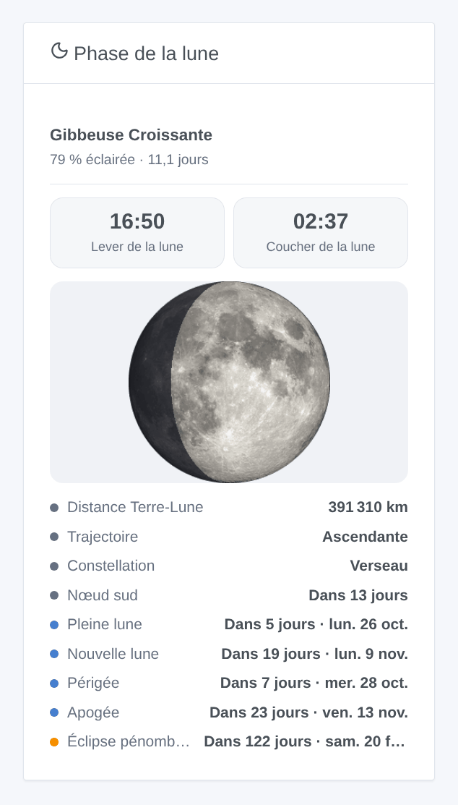
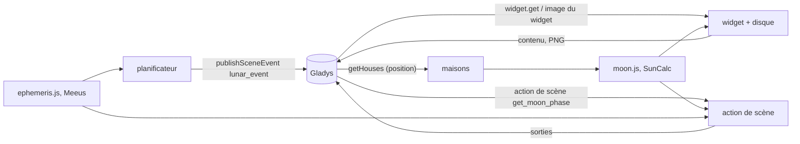
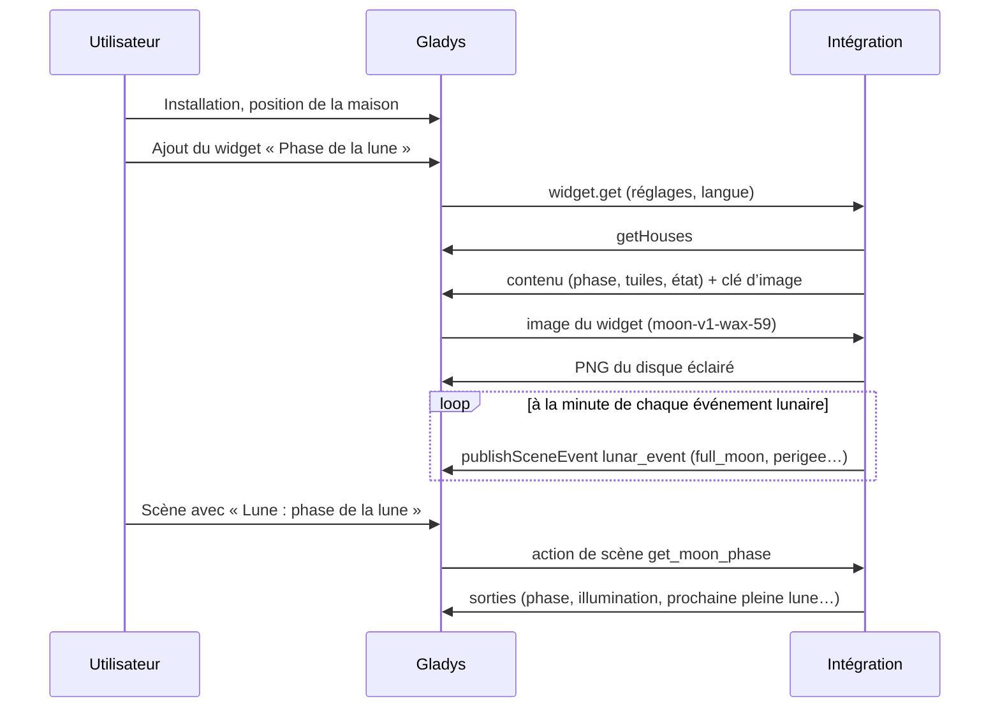
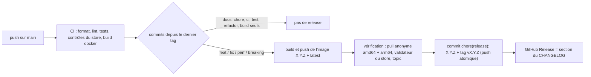

# Gladys Phase de la lune

[English](README.md) · **Français** · [Deutsch](README.de.md) · [Español](README.es.md)

[](LICENSE)
[](https://github.com/William-De71/gladys-moon-phase/releases)
[](https://github.com/William-De71/gladys-moon-phase/actions/workflows/release.yml)
[](https://gladysassistant.com)


Intégration externe de [Gladys Assistant](https://gladysassistant.com) qui ajoute un **widget de tableau de bord
« Phase de la lune »** : phase, illumination et âge, disque lunaire, lever et coucher, et prochains événements
lunaires (pleine et nouvelle lune, périgée, apogée, éclipse de lune). Les scènes disposent d’un **déclencheur à la
minute de chaque événement lunaire** et d’une **action donnant la phase de la lune**. Construite sur
`@gladysassistant/integration-sdk` 0.15.

**Zéro configuration, entièrement local** : tout est calculé à partir de la position de la maison, sans compte, sans
clé et sans accès Internet.



Documentation utilisateur : [English](docs/en.md) · [Français](docs/fr.md) · [Deutsch](docs/de.md) ·
[Español](docs/es.md).

## Sommaire

- [Fonctionnalités](#fonctionnalités)
- [Architecture](#architecture)
- [Installation](#installation)
- [Configuration](#configuration)
- [Origine](#origine)
- [Le widget](#le-widget)
- [Scènes](#scènes)
- [Développement](#développement)
- [Release et convention de commits](#release-et-convention-de-commits)
- [Dépannage](#dépannage)
- [Contribuer](#contribuer)
- [Crédits](#crédits)
- [Licence](#licence)

## Fonctionnalités

- **Widget** `moon` : phase, pourcentage éclairé et âge, disque lunaire éclairé (photo NASA), lever et coucher,
  puis distance, trajectoire, constellation et prochain nœud du jour, et prochaines pleine lune, nouvelle lune,
  périgée, apogée et éclipse de lune avec leur décompte.
- **Déclencheur de scène** `lunar_event` : à la minute d’une nouvelle lune, d’un premier quartier, d’une pleine
  lune, d’un dernier quartier, d’un périgée, d’un apogée ou d’une éclipse de lune, avec un filtre sur l’événement.
- **Action de scène** `get_moon_phase` : phase, illumination, âge, lever et coucher pour une maison, prochaines
  pleine et nouvelle lunes, et une phrase prête à l’emploi.
- **Transport** : `local` (l’intégration apparaît sous « Local » dans Gladys) : rien ne sort du conteneur.
- **Langues** : anglais, français, allemand et espagnol (manifeste, widget, textes de scène, docs).

## Architecture




Du tableau de bord à une scène :



L’intégration déclare `transports: ["local"]` : elle calcule tout dans son conteneur et ne parle qu’à Gladys.

## Installation

Depuis Gladys : **Intégrations → store → Phase de la lune → Installer**. Renseignez la position de la maison
(**Paramètres → Maisons**), puis ajoutez le widget **Phase de la lune** à un tableau de bord. Voir la
[documentation utilisateur](docs/fr.md).

Image Docker : `ghcr.io/william-de71/gladys-moon-phase`, multi-architecture (amd64/arm64), utilisateur non root,
système de fichiers en lecture seule, écriture dans `/data` uniquement, labels OCI et manifeste dans le label
`io.gladysassistant.manifest`.

## Configuration

| Clé        | Type     | Remarques                                                                                          |
| ---------- | -------- | -------------------------------------------------------------------------------------------------- |
| `language` | `select` | langue des textes de scène : `auto` (défaut, la langue du tableau de bord), `en`, `fr`, `de`, `es` |

Clé interne (hors schéma) : `last_language`, la langue de la dernière demande de widget. Le widget a lui-même trois
réglages (maison, détails, calcul à minuit), voir plus bas.

## Origine

Ce widget est né comme widget du cœur de Gladys (PR #2990, branche `feat/moon-phase-widget`). Il est devenu une
intégration externe pour ne pas alourdir le cœur : le calcul est un portage de
`server/lib/house/house.getMoonState.js` (même version de `suncalc`, mêmes séries, mêmes recherches) et ses tests
sont portés dans `test/moon.test.js`. Une comparaison sur 864 instants de 2026 (Paris, Sydney, New York, en direct et
à minuit) a donné des résultats strictement identiques.

## Le widget

Une intégration `provider` (manifeste `type: "provider"`) : pas d’appareils, un widget, `moon`.

| Widget du cœur (PR #2990)                                         | Cette intégration                                        |
| ----------------------------------------------------------------- | -------------------------------------------------------- |
| Nom de la phase                                                   | `text` titre                                             |
| « 75 % éclairée · 10,2 jours »                                    | `text` légende                                           |
| Disque lunaire : photo NASA, ombre #11131c à 70 %                 | `image`, la même photo ombrée côté serveur (PNG, 256 px) |
| Lever / coucher                                                   | deux tuiles `value`                                      |
| « Aujourd’hui » : distance, trajectoire, constellation, nœud      | quatre premières lignes de la liste `status`             |
| « À venir » : pleine / nouvelle lune, périgée, apogée, éclipse    | cinq lignes suivantes, « Dans 5 jours · ven. 28 août »   |
| Décomptes en jours calendaires de la maison (correctif e15d92ba2) | idem, dans le fuseau horaire de Gladys                   |
| Réglages : maison, afficher les détails, calculer à minuit        | les trois mêmes réglages de widget                       |
| Textes en anglais, français, allemand                             | mêmes textes, plus l’espagnol (autre langue : anglais)   |

6 composants sur le budget de 8. Ce que le vocabulaire ne sait pas exprimer (le disque à côté du texte au lieu d’un
cadre 16:9 pleine largeur, deux sections titrées, la date en gris à côté du décompte) a été listé lors du test du
vocabulaire des widgets (branche `feat/dev-widget-test`, `CORE-NEEDS.md`).

### Fuseau horaire

Le superviseur démarre chaque conteneur d’intégration avec `TZ` réglé sur le fuseau de Gladys : le lever, le
coucher, l’instant « calculer à minuit » et les décomptes en jours le suivent (`src/time.js`, sur `Intl`, sans
bibliothèque de dates). La durée de vie du contenu est de 10 minutes, raccourcie pour se terminer juste après minuit
afin que les décomptes avancent à l’heure ; les valeurs calculées à minuit sont gardées jusqu’à une heure.

### Maison

Le réglage « Maison » est un texte libre : le nom ou le sélecteur de la maison, sans tenir compte de la casse ; vide,
c’est la première maison localisée. Une liste des maisons (`source: "houses"`) existe sur la branche master de Gladys
mais dans aucune version publiée, et Gladys 5.1 refuse un manifeste qui l’utilise. Les maisons sont lues via l’API
hôte (`location: true`, `getHouses()`), au plus une fois par minute.

### Image

Le disque est servi par `onWidgetGetImage`. La clé porte tout ce dont dépend le dessin (`moon-v1-wax-59` : version
du dessin, croissante ou décroissante, pourcentage éclairé) : les octets ne changent que si la clé change, et le
disque se reconstruit à partir de la seule clé après un redémarrage. Dessiné avec `pngjs` (JavaScript pur, aucun
binaire natif par architecture), environ 90 Ko, gardé en mémoire (202 clés au plus).

Comme dans le widget du cœur, l’ombre reste verticale, comme sur un calendrier lunaire (éclairée à droite quand la
lune croît).

## Scènes

### Déclencheur « Lune : événement lunaire »

| Événement (`event`) | Quand                                                                  |
| ------------------- | ---------------------------------------------------------------------- |
| `new_moon`          | la lune et le soleil ont la même longitude                             |
| `first_quarter`     | 90° d’écart                                                            |
| `full_moon`         | 180° d’écart                                                           |
| `last_quarter`      | 270° d’écart                                                           |
| `perigee`           | la lune est au plus près de la Terre                                   |
| `apogee`            | la lune est au plus loin de la Terre                                   |
| `lunar_eclipse`     | une pleine lune assez proche d’un nœud (pénombrale, partielle, totale) |

Filtre : les événements auxquels réagir (vide : tous). Variables : `event`, `event_name`, `date`, `time`,
`illumination`, `distance_km`, `summary` (« Pleine lune à 05:11 : la lune est éclairée à 100 %, à 368 600 km de la
Terre. »).

Le widget garde le calcul du widget du cœur (SunCalc), dont la « phase » est un angle de phase : sa pleine lune peut
tomber à plusieurs heures de la pleine lune astronomique. Le déclencheur a besoin de la minute : ses instants
viennent de `src/ephemeris.js`, avec les principaux termes de la série ELP-2000/82 tels que donnés par J. Meeus
(_Astronomical Algorithms_, chapitre 47) et le soleil du chapitre 25. Vérifié contre PyEphem sur 200 phases
(2026-2033) : 3 minutes d’écart au plus ; périgée et apogée à 34 minutes près (la courbe de distance y est plate).
Une éclipse est datée à sa pleine lune (à moins d’une demi-heure du maximum de l’éclipse).

Chaque événement n’est déclenché qu’une fois (gardé 40 jours dans `/data/fired.json`, un redémarrage ne le redéclenche
donc jamais) ; un événement manqué de plus de 10 minutes (conteneur arrêté) est abandonné, et la publication est
réessayée chaque minute tant que Gladys est injoignable.

Exemples : passer l’éclairage du jardin en scène « pleine lune », recevoir un message le soir d’une éclipse de lune,
se rappeler de semer à la nouvelle lune.

### Action « Lune : phase de la lune »

Champ : la maison (vide : la première maison localisée). Sorties : `phase_name`, `phase` (0 nouvelle lune, 0,5
pleine lune), `illumination`, `age_days`, `waxing`, `moonrise`, `moonset` (HH:MM, vides quand la lune ne se lève ou
ne se couche pas ce jour-là), `next_full_moon`, `days_until_full_moon`, `next_new_moon`, `days_until_new_moon`,
`summary`.

Les textes de scène suivent le réglage **Langue des textes de scène** : Gladys ne donne la langue qu’aux widgets.

## Développement

```bash
npm install
npm run format:check
npm run lint
npm test
npx github:GladysAssistant/integration-store . --skip-image-check
docker build -t gladys-moon-phase .
```

Node 22 ou plus récent. `npm start` nécessite un Gladys en marche (le SDK lit `GLADYS_HOST_API_URL`,
`GLADYS_INTEGRATION_TOKEN` et `GLADYS_INTEGRATION_SELECTOR`, fournis par le superviseur). Les tests (`node --test`)
n’accèdent jamais au réseau. En plus des tests unitaires :

- `test/structure.test.js` compare toutes les clés du manifeste et les clés d’image à
  `test/fixtures/discovery.baseline.json` (version 1.0.0) : aucun réglage de widget n’est perdu lors d’une mise à
  jour ;
- `test/i18n.test.js` vérifie les quatre langues (manifeste, textes à l’exécution, docs, README) et valide le
  widget dans chacune ;
- `test/events.test.js` vérifie les instants des événements lunaires contre PyEphem ;
- `test/release.test.js` couvre le script de release (version, changelog, montée de version).
- `docs/illustrations/render.sh` régénère les illustrations du widget de `docs/assets` à partir du code du widget
  (Chrome headless, styles du front Gladys) : relancez-le après tout changement du widget.

`gladys_version` vaut `>=5.1.1` (widgets, déclencheurs et actions de scène des intégrations externes). Pour le
développement uniquement, `MOON_DATA_DIR` déplace les fichiers de `/data`.

## Release et convention de commits

Les releases sont automatiques. Chaque push sur `main` lance le workflow Release :



- Les commits et titres de PR suivent les [Conventional Commits](https://www.conventionalcommits.org/), en
  anglais, rédigés pour l’utilisateur : ils deviennent les lignes du changelog. `feat` → minor, `fix` / `perf` →
  patch, `!` ou `BREAKING CHANGE:` → major.
- `CHANGELOG.md` est généré à la release : ne jamais le modifier à la main.
- L’image est publiée et vérifiée **avant** que le manifeste sur `main` annonce la nouvelle version.
- Lancement manuel (Actions → Release → Run workflow) : `release-as` force une version, `dry-run` affiche seulement
  la version et les notes.
- Une branche `main` protégée refuserait le commit de release : autorisez GitHub Actions à contourner la règle, ou
  utilisez le jeton d’une GitHub App.

## Dépannage

| Symptôme                                    | Cause probable                                                                             |
| ------------------------------------------- | ------------------------------------------------------------------------------------------ |
| « Aucune maison de Gladys n’est localisée » | renseignez la position d’une maison dans Paramètres → Maisons                              |
| « Aucune maison nommée … »                  | le réglage Maison ne correspond à aucune maison : le message liste les noms à utiliser     |
| Heures décalées                             | vérifiez le fuseau horaire de Gladys (Paramètres → Système), puis redémarrez l’intégration |
| Textes de scène en anglais                  | réglez **Langue des textes de scène**, ou affichez une fois le widget                      |
| Pas de `lunar_event` après un redémarrage   | un événement manqué de plus de 10 minutes est volontairement abandonné                     |

Logs détaillés : définissez la variable d’environnement `DEBUG=gladys-integration-sdk` sur le conteneur.

## Contribuer

Les issues et pull requests sont les bienvenues : signalements de bug avec la version de Gladys, celle de
l’intégration, le fuseau horaire et l’hémisphère de la maison, et les logs ([modèles d’issue](.github/ISSUE_TEMPLATE)).
Les retours sont aussi bienvenus sur le
[fil du forum Gladys](https://community.gladysassistant.com/t/integration-externe-phase-de-la-lune/11042).
Problèmes de sécurité : voir [SECURITY.md](SECURITY.md).

## Crédits

Photo de la lune : NASA’s Scientific Visualization Studio, domaine public — voir
[assets/CREDITS.md](assets/CREDITS.md).

## Licence

[Apache-2.0](LICENSE) — voir [NOTICE](NOTICE).
