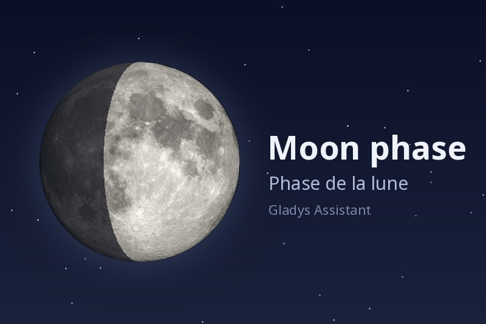
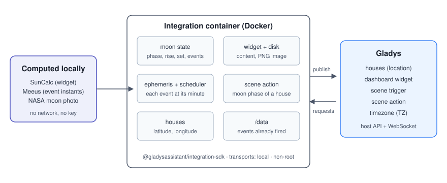
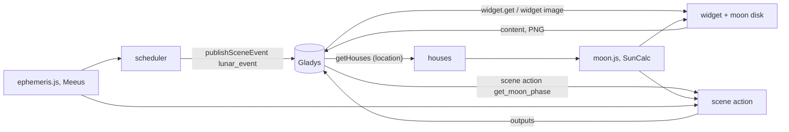
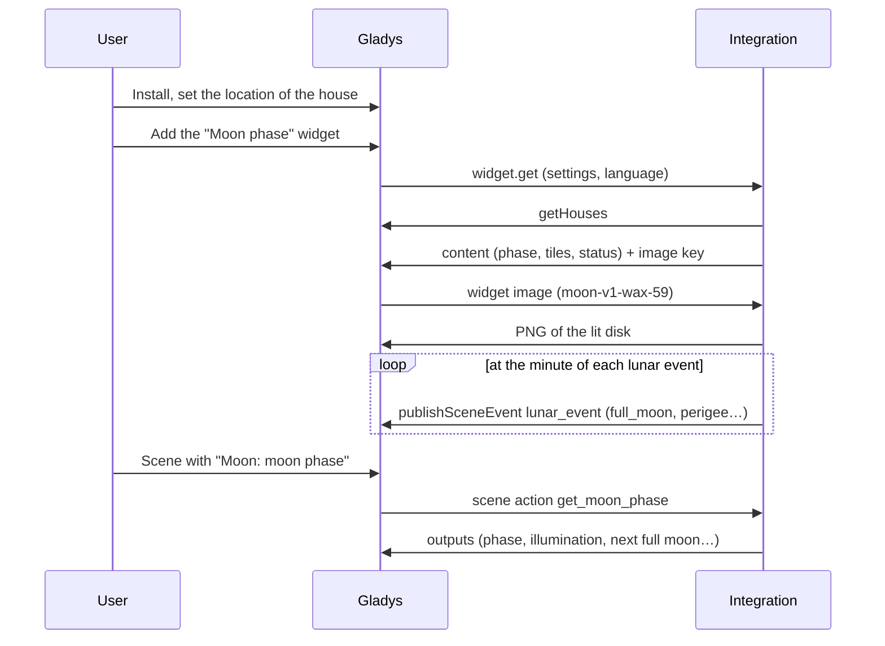
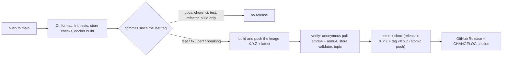

# Gladys Moon phase

**English** · [Français](README.fr.md) · [Deutsch](README.de.md) · [Español](README.es.md)

[](LICENSE)
[](https://github.com/William-De71/gladys-moon-phase/releases)
[](https://github.com/William-De71/gladys-moon-phase/actions/workflows/release.yml)
[](https://gladysassistant.com)



External [Gladys Assistant](https://gladysassistant.com) integration adding a **moon phase dashboard widget**:
phase, illumination and age, the moon disk, moonrise and moonset, and the upcoming lunar events (full and new moon,
perigee, apogee, lunar eclipse). Scenes get a **trigger at the minute of each lunar event** and an **action giving
the phase of the moon**. Built on `@gladysassistant/integration-sdk` 0.15.

**Zero configuration, fully local**: everything is computed from the location of the house, with no account, no
key and no internet access.

User documentation: [English](docs/en.md) · [Français](docs/fr.md) · [Deutsch](docs/de.md) · [Español](docs/es.md).

## Contents

- [Features](#features)
- [Architecture](#architecture)
- [Installation](#installation)
- [Configuration](#configuration)
- [Origin](#origin)
- [The widget](#the-widget)
- [Scenes](#scenes)
- [Development](#development)
- [Release and commit convention](#release-and-commit-convention)
- [Troubleshooting](#troubleshooting)
- [Contributing](#contributing)
- [Credits](#credits)
- [License](#license)

## Features

- **Widget** `moon`: phase, illuminated percentage and age, the lit moon disk (NASA photo), moonrise and moonset,
  then today's distance, trajectory, constellation and next node, and the upcoming full moon, new moon, perigee,
  apogee and lunar eclipse with their countdowns.
- **Scene trigger** `lunar_event`: fired at the minute of a new moon, first quarter, full moon, last quarter,
  perigee, apogee or lunar eclipse, with a filter on the event.
- **Scene action** `get_moon_phase`: the phase, illumination, age, moonrise and moonset of a house, the next full
  and new moon, and a ready-made sentence.
- **Transport**: `local` (the integration is listed under "Local" in Gladys): nothing leaves the container.
- **Languages**: English, French, German and Spanish (manifest, widget, scene texts, docs).

## Architecture





From the dashboard to a scene:



The integration declares `transports: ["local"]`: it computes everything in its container and talks only to Gladys.

## Installation

From Gladys: **Integrations → store → Moon phase → Install**. Set the location of the house (**Settings → Houses**),
then add the **Moon phase** widget to a dashboard. See the [user documentation](docs/en.md).

Docker image: `ghcr.io/william-de71/gladys-moon-phase`, multi-arch (amd64/arm64), non-root, read-only rootfs, writes
in `/data` only, OCI labels and the manifest as the `io.gladysassistant.manifest` label.

## Configuration

| Key        | Type     | Notes                                                                                                |
| ---------- | -------- | ---------------------------------------------------------------------------------------------------- |
| `language` | `select` | language of the scene texts: `auto` (default, the language of the dashboard), `en`, `fr`, `de`, `es` |

Internal key (outside the schema): `last_language`, the language of the last widget request. The widget itself has
three settings (house, display details, compute at midnight), see below.

## Origin

This widget started as a core widget of Gladys (PR #2990, branch `feat/moon-phase-widget`). It became an external
integration so it does not weigh on the core: the computation is a port of `server/lib/house/house.getMoonState.js`
(same `suncalc` version, same series, same searches) and its tests are ported in `test/moon.test.js`. A parity run
over 864 instants of 2026 (Paris, Sydney, New York, live and at midnight) gave strictly identical results.

## The widget

A `provider` integration (manifest `type: "provider"`): no devices, one widget, `moon`.

| Core widget (PR #2990)                                         | This integration                                         |
| -------------------------------------------------------------- | -------------------------------------------------------- |
| Phase name                                                     | `text` heading                                           |
| « 75 % éclairée · 10,2 jours »                                 | `text` caption                                           |
| Moon disk: NASA photo, shadow #11131c at 70 %                  | `image`, the same photo shaded server side (PNG, 256 px) |
| Moonrise / moonset                                             | two `value` tiles                                        |
| « Today »: distance, trajectory, constellation, next node      | first four lines of the `status` list                    |
| « Upcoming »: full / new moon, perigee, apogee, eclipse + date | five next lines, « Dans 5 jours · ven. 28 août »         |
| Countdowns in calendar days of the house (fix e15d92ba2)       | same, in the timezone of Gladys                          |
| Settings: house, display details, compute at midnight          | same three widget settings                               |
| Texts in English, French, German                               | same texts, plus Spanish (any other language: English)   |

6 components out of the budget of 8. What the vocabulary cannot express (the disk next to the text instead of a
full-width 16:9 frame, two titled sections, the date in grey next to the countdown) was listed during the test of
the widget vocabulary (branch `feat/dev-widget-test`, `CORE-NEEDS.md`).

### Timezone

The supervisor starts every integration container with `TZ` set to the timezone of Gladys: moonrise, moonset, the
« compute at midnight » instant and the day countdowns follow it (`src/time.js`, on top of `Intl`, no date library).
The content TTL is 10 minutes, cut short to just after midnight so the countdowns move on time; values computed at
midnight are kept up to an hour.

### House

The « House » setting is a free text: the house name or selector, any case; empty means the first house with a
location. A list of the houses (`source: "houses"`) exists on the master branch of Gladys but in no release yet,
and Gladys 5.1 refuses a manifest using it. The houses are read through the host API (`location: true`,
`getHouses()`), at most once a minute.

### Image

The disk is served through `onWidgetGetImage`. The key carries everything the drawing depends on
(`moon-v1-wax-59`: drawing version, waxing or waning, illuminated percentage), so the bytes change only when the key
does, and the disk is rebuilt from the key alone after a restart. Drawn with `pngjs` (pure JavaScript, no native
binary per architecture), about 90 KB, cached in memory (202 keys at most).

As in the core widget, the shadow stays vertical, like on a lunar calendar (lit on the right while waxing).

## Scenes

### Trigger "Moon: lunar event"

| Event (`event`) | When                                                             |
| --------------- | ---------------------------------------------------------------- |
| `new_moon`      | the moon and the sun have the same longitude                     |
| `first_quarter` | 90° apart                                                        |
| `full_moon`     | 180° apart                                                       |
| `last_quarter`  | 270° apart                                                       |
| `perigee`       | the moon is at its closest to the Earth                          |
| `apogee`        | the moon is at its farthest from the Earth                       |
| `lunar_eclipse` | a full moon close enough to a node (penumbral, partial or total) |

Filter: the events to react to (empty: all). Variables: `event`, `event_name`, `date`, `time`, `illumination`,
`distance_km`, `summary` ("Full moon at 05:11: the moon is 100 % illuminated, 368,600 km from the Earth.").

The widget keeps the computation of the core widget (SunCalc), whose "phase" is a phase angle: its full moon can be
hours away from the astronomical one. The trigger needs the minute, so its instants come from `src/ephemeris.js`:
the main terms of the ELP-2000/82 series as given by J. Meeus (_Astronomical Algorithms_, chapter 47) and the sun of
chapter 25. Checked against PyEphem over 200 phases (2026-2033): at most 3 minutes off; perigee and apogee within 34
minutes (the distance curve is flat there). An eclipse is dated at its full moon (within half an hour of the
greatest eclipse).

Each event is fired once (kept 40 days in `/data/fired.json`, so a restart never fires it twice); an event missed
by more than 10 minutes (container stopped) is dropped, and the publication is retried every minute while Gladys
cannot be reached.

Examples: switch the garden lights to the "full moon" scene, get a message the evening of a lunar eclipse,
remind yourself to sow on the new moon.

### Action "Moon: moon phase"

Field: the house (empty: the first located house). Outputs: `phase_name`, `phase` (0 new moon, 0.5 full moon),
`illumination`, `age_days`, `waxing`, `moonrise`, `moonset` (HH:MM, empty when the moon does not rise or set that
day), `next_full_moon`, `days_until_full_moon`, `next_new_moon`, `days_until_new_moon`, `summary`.

The scene texts use the **Language of the scene texts** setting: Gladys gives the language to the widgets only.

## Development

```bash
npm install
npm run format:check
npm run lint
npm test
npx github:GladysAssistant/integration-store . --skip-image-check
docker build -t gladys-moon-phase .
```

Node 22 or later. `npm start` needs a running Gladys (the SDK reads `GLADYS_HOST_API_URL`,
`GLADYS_INTEGRATION_TOKEN` and `GLADYS_INTEGRATION_SELECTOR`, set by the supervisor). The tests (`node --test`) never
touch the network. Beyond the unit tests:

- `test/structure.test.js` compares every key of the manifest and the image keys with
  `test/fixtures/discovery.baseline.json` (version 1.0.0): no widget setting is lost on an update;
- `test/i18n.test.js` checks the four languages (manifest, runtime texts, docs, READMEs) and validates the widget in
  each;
- `test/events.test.js` checks the instants of the lunar events against PyEphem;
- `test/release.test.js` covers the release script (version, changelog, bump).

`gladys_version` is `>=5.1.1` (widgets, scene triggers and actions of external integrations). For development only,
`MOON_DATA_DIR` moves the files of `/data`.

## Release and commit convention

Releases are automatic. Every push to `main` runs the Release workflow:



- Commits and PR titles follow [Conventional Commits](https://www.conventionalcommits.org/), in English, written
  for the user: they become the changelog lines. `feat` → minor, `fix` / `perf` → patch, `!` or `BREAKING
CHANGE:` → major.
- `CHANGELOG.md` is generated at the release: never edit it by hand.
- The image is published and checked **before** the manifest on `main` announces the new version.
- Manual run (Actions → Release → Run workflow): `release-as` forces a version, `dry-run` only shows the version
  and the notes.
- A protected `main` would reject the release commit: allow GitHub Actions to bypass the rule, or use a GitHub
  App token.

## Troubleshooting

| Symptom                             | Likely cause                                                                   |
| ----------------------------------- | ------------------------------------------------------------------------------ |
| "No house of Gladys has a location" | set the location of a house in Settings → Houses                               |
| "No house named …"                  | the House setting matches no house: the message lists the names to use         |
| Times are off                       | check the timezone of Gladys (Settings → System), then restart the integration |
| Scene texts in English              | set **Language of the scene texts**, or display the widget once                |
| No `lunar_event` after a restart    | an event missed by more than 10 minutes is dropped on purpose                  |

Detailed logs: set the environment variable `DEBUG=gladys-integration-sdk` on the container.

## Contributing

Issues and pull requests are welcome: bug reports with the Gladys version, the integration version, the timezone and
hemisphere of the house and the logs ([issue templates](.github/ISSUE_TEMPLATE)). Feedback on the
[Gladys forum thread](https://community.gladysassistant.com/t/integration-externe-phase-de-la-lune/11042) too.
Security problems: see [SECURITY.md](SECURITY.md).

## Credits

Moon photo: NASA's Scientific Visualization Studio, public domain — see [assets/CREDITS.md](assets/CREDITS.md).

## License

[Apache-2.0](LICENSE) — see [NOTICE](NOTICE).
